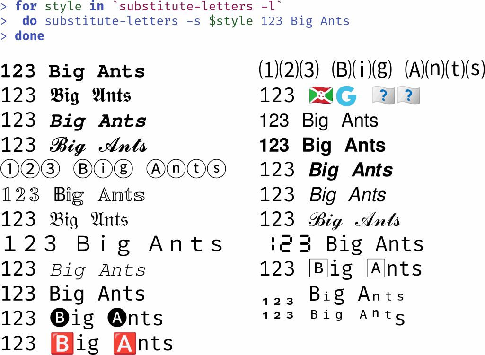

# substitute-letters

Perl-модуль и CLI-утилита для замены латинских букв на похожие символы
из других диапазонов Unicode — математические алфавитные символы
(monospace, script, fraktur, doublestruck, sans-serif и их начертания),
обведённые формы (circled, parenthesized, squared и их инвертированные
варианты), fullwidth и другие. Например, `ABC` → `𝙰𝙱𝙲` (monospace)
или `𝒜ℬ𝒞` (script). Стиль `regional_indicator` превращает двухбуквенные
коды стран в флаги-эмодзи: `RU` → 🇷🇺, `US` → 🇺🇸.

Пробелы и прочие не-буквы не изменяются —
кроме стилей `bold`, `circled`, `doublestruck`, `fullwidth`,
`monospace`, `parenthesized`, `sans_serif`, `sans_serif_bold` и
`segmented`, в которых также преобразуются цифры `0-9` (у
`parenthesized` нет глифа для `0`), а стиль `fullwidth`
дополнительно переводит всю печатаемую ASCII-пунктуацию (включая
`_`) в полноширинную форму. Стиль `segmented` покрывает только цифры;
стили `subscript` и `superscript` — цифры, знаки `+ - = ( )` и только
те буквы, для которых такие формы существуют; стили `squared`,
`negative_circled` и `negative_squared` — только заглавные буквы. Греческие буквы (U+0391..U+03C9) также
преобразуются в стилях `bold`, `italic`, `bold_italic`,
`sans_serif_bold` и `sans_serif_bold_italic`.

Документация на английском языке: [README.md](README.md)

Пример вывода:


Репозиторий: <https://github.com/shoorick/substitute-letters> —
багрепорты и другие issues приветствуются:
<https://github.com/shoorick/substitute-letters/issues>

## Возможности

- `Text::UnicodeStyle` — API: `stylize($string, $style)` и `styles()`
- `bin/substitute-letters` — CLI-обёртка с `Getopt::Long`
- 23 стиля: `bold`, `bold_fraktur`, `bold_italic`, `bold_script`,
  `circled`, `doublestruck`, `fraktur`, `fullwidth`, `italic`,
  `monospace`, `negative_circled`, `negative_squared`, `parenthesized`,
  `regional_indicator`, `sans_serif`, `sans_serif_bold`,
  `sans_serif_bold_italic`, `sans_serif_italic`, `script`, `segmented`,
  `squared`, `subscript`, `superscript`

## Использование CLI

```sh
# текст аргументами (склеиваются через пробел)
bin/substitute-letters --style script 'Hello, World!'
bin/substitute-letters -s fraktur route_id

# или через stdin
echo mkdir folder_name | bin/substitute-letters -s monospace

# список доступных стилей
bin/substitute-letters --list

# справка
bin/substitute-letters --help
```

Опции: `-s/--style STYLE` (по умолчанию `monospace`), `-l/--list`,
`-h/-?/--help`.

## Установка

Из этого репозитория (зависимостей, кроме core-модулей, нет):

```sh
perl Makefile.PL && make && sudo make install
# или просто:
cpanm .
```

После установки `Text::UnicodeStyle` и скрипт `substitute-letters`
доступны системно.

## Использование модуля

```perl
use lib 'lib';
use Text::UnicodeStyle qw( stylize styles );

say stylize('some_id', 'italic');   # 𝑠𝑜𝑚𝑒_𝑖𝑑
say join ', ', styles();
```

`stylize` возвращает новую строку, исходник не изменяет.

## Тесты

```sh
prove -Ilib t/
```

`t/stylize.t` проверяет API и таблицы преобразований, `t/cli.t` —
поведение CLI (включая коды возврата и help).

## Пример

`example.pl` — демо-скрипт, использующий модуль.

## Структура

```
lib/Text/UnicodeStyle.pm    # API модуля
lib/Text/UnicodeStyle/*.pm  # таблицы стилей (lazy load)
bin/substitute-letters      # CLI
t/                          # тесты (Test::More + prove)
example.pl                  # пример
```

## Лицензия

[MIT](LICENSE)

## Автор

Александр Сапожников <shoorick@cpan.org> <http://shoorick.ru>

## Support the project

Если вы считаете этот проект полезным, можете поддержать разработку через [PayPal](https://paypal.me/shoorick77).
